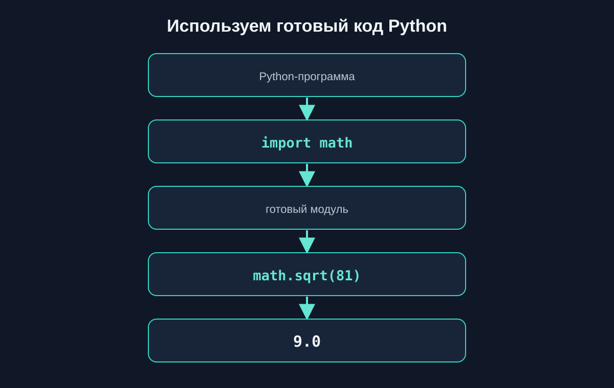
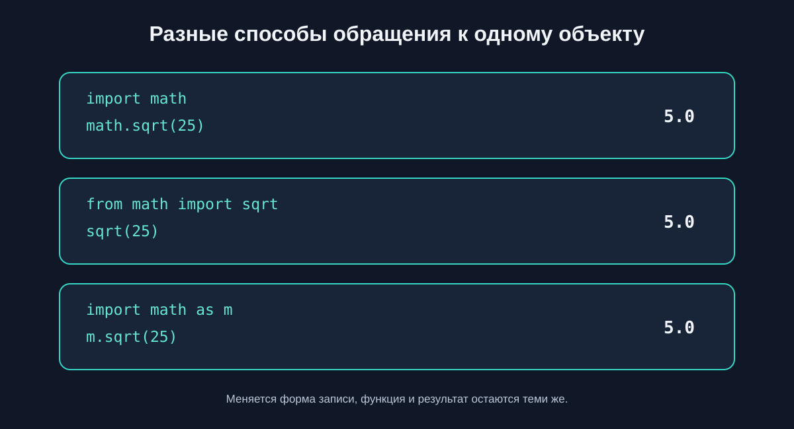
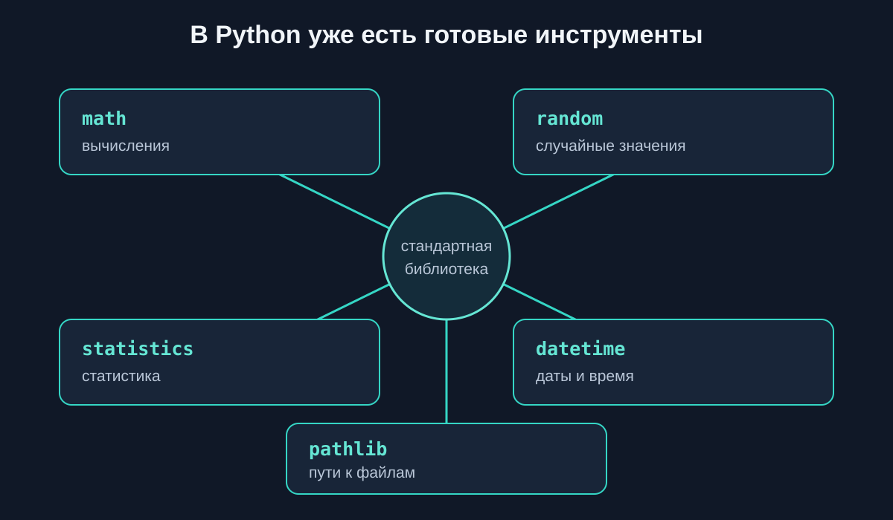
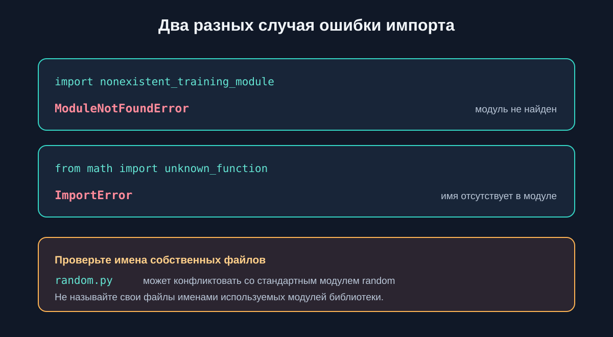

# 4.8 Модули и импорты {.unnumbered}

## Что такое модуль

Модуль — это готовый набор кода Python, который можно подключить командой `import`. В этой главе мы используем модули стандартной библиотеки: они уже поставляются вместе с Python и не требуют отдельной установки.

Модули помогают не писать заново типовые инструменты. Например, `math` умеет вычислять квадратный корень, а `statistics` — среднее значение набора чисел.



## Первый импорт

Команда `import math` подключает модуль `math`. К его объектам обращаются через точку: сначала указывают имя модуля, затем имя функции или константы.

::: {.content-visible when-format="html"}
::: {.python-playground data-source="../examples/chapter28/import-math.py" data-title="Импорт модуля math"}
:::
:::

::: {.content-visible when-format="pdf"}
```{.python filename="import-math.py"}

```
:::

Здесь `math.sqrt()` вычисляет квадратный корень, `math.ceil()` округляет вверх, а `math.floor()` — вниз.

## Импорт конкретных объектов

Если нужны только отдельные объекты, их можно перечислить после `from ... import`. После этого к ним обращаются по имени, без префикса модуля.

::: {.content-visible when-format="html"}
::: {.python-playground data-source="../examples/chapter28/from-import.py" data-title="Импорт отдельных функций"}
:::
:::

::: {.content-visible when-format="pdf"}
```{.python filename="from-import.py"}

```
:::

Можно импортировать несколько имён через запятую, как в примере выше. `from math import sqrt, ceil` подключает обе функции.

## Псевдонимы через as

Слово `as` задаёт другое имя для обращения к модулю или импортированному объекту. Выбирайте короткий, но понятный псевдоним.

::: {.content-visible when-format="html"}
::: {.python-playground data-source="../examples/chapter28/import-alias.py" data-title="Псевдоним модуля"}
:::
:::

::: {.content-visible when-format="pdf"}
```{.python filename="import-alias.py"}

```
:::

Имя `m` в этом примере — псевдоним `math`, а `m.sqrt(49)` вызывает ту же функцию, что и `math.sqrt(49)`.



## Какой способ импорта выбрать

Три формы дают доступ к одному объекту, но выглядят по-разному:

| Запись | Обращение к функции | Когда удобно |
|---|---|---|
| `import math` | `math.sqrt(25)` | Видно, откуда взято имя; удобно использовать несколько объектов модуля |
| `from math import sqrt` | `sqrt(25)` | Нужна одна или несколько конкретных функций |
| `import math as m` | `m.sqrt(25)` | Псевдоним делает длинное имя удобнее |

Для начинающего хороший выбор по умолчанию — `import math`: происхождение каждого имени остаётся видимым. `from ... import ...` подходит, когда список нужных объектов небольшой и понятный. Не используйте `from math import *`: в коде не видно, откуда пришли имена, и они могут случайно совпасть с другими именами.

## Стандартная библиотека Python

Стандартная библиотека — набор модулей, который поставляется с Python. В этой главе мы познакомимся с несколькими практичными инструментами.



## Математические вычисления

В модуле `math` есть математические функции и константы. Например, `math.pi` хранит приближённое значение числа π. Площадь круга вычисляется по формуле `πr²`.

::: {.content-visible when-format="html"}
::: {.python-playground data-source="../examples/chapter28/math-calculations.py" data-title="Площадь круга с math.pi"}
:::
:::

::: {.content-visible when-format="pdf"}
```{.python filename="math-calculations.py"}

```
:::

## Случайные значения

Модуль `random` позволяет выбрать случайный элемент или получить случайное число. При каждом запуске результат может меняться.

::: {.content-visible when-format="html"}
::: {.python-playground data-source="../examples/chapter28/random-choice.py" data-title="Случайный выбор участника"}
:::
:::

::: {.content-visible when-format="pdf"}
```{.python filename="random-choice.py"}

```
:::

`random.randint(1, 6)` возвращает целое число от 1 до 6. Обе границы включены.

::: {.content-visible when-format="html"}
::: {.python-playground data-source="../examples/chapter28/random-numbers.py" data-title="Случайное число от 1 до 6"}
:::
:::

::: {.content-visible when-format="pdf"}
```{.python filename="random-numbers.py"}

```
:::

## Статистические вычисления

Модуль `statistics` помогает находить основные показатели набора чисел. `mean()` вычисляет среднее арифметическое, а `median()` — медиану.

::: {.content-visible when-format="html"}
::: {.python-playground data-source="../examples/chapter28/statistics-example.py" data-title="Среднее и медиана"}
:::
:::

::: {.content-visible when-format="pdf"}
```{.python filename="statistics-example.py"}

```
:::

## Даты и время

Из модуля `datetime` можно импортировать нужный класс. Например, `date` представляет календарную дату с годом, месяцем и днём.

::: {.content-visible when-format="html"}
::: {.python-playground data-source="../examples/chapter28/datetime-example.py" data-title="Работа с календарной датой"}
:::
:::

::: {.content-visible when-format="pdf"}
```{.python filename="datetime-example.py"}

```
:::

## Работа с путями

`pathlib` предоставляет объект `Path` для представления путей. С его помощью удобно соединять части пути и получать имя или расширение. Для этого примера файл на диске не нужен.

::: {.content-visible when-format="html"}
::: {.python-playground data-source="../examples/chapter28/pathlib-example.py" data-title="Части пути к файлу"}
:::
:::

::: {.content-visible when-format="pdf"}
```{.python filename="pathlib-example.py"}

```
:::

## Ошибки при импорте

Если Python не находит запрошенный модуль, возникает `ModuleNotFoundError`. Если модуль существует, но в нём нет указанного имени, возникает `ImportError`.

::: {.content-visible when-format="html"}
::: {.python-playground data-source="../examples/chapter28/import-errors.py" data-title="Два сценария ошибки импорта"}
:::
:::

::: {.content-visible when-format="pdf"}
```{.python filename="import-errors.py"}

```
:::

Имена файлов могут конфликтовать с именами стандартной библиотеки. Например, собственный файл `random.py` способен помешать импорту стандартного модуля `random`. Не называйте свои файлы именами используемых стандартных модулей.



## Что важно запомнить

- Готовые модули Python дают полезные инструменты без необходимости писать их заново.
- `import module` подключает модуль, а точка отделяет его имя от функции или константы.
- `from module import name` подключает перечисленные объекты, а `as` задаёт псевдоним.
- Используйте явные импорты; `from module import *` затрудняет чтение кода.
- `math`, `random`, `statistics`, `datetime` и `pathlib` входят в стандартную библиотеку.
- `ModuleNotFoundError` означает, что модуль не найден; `ImportError` может означать, что в модуле нет запрошенного имени.

### Практические задания

#### Задание 1. Геометрия

**Условие.** Длина окружности равна `2πr`. Вычислите её для радиуса 3.5, используя `math.pi`, и выведите результат с округлением до двух знаков.

**Исходные данные:** `radius = 3.5`.

**Ожидаемое поведение:** программа выводит одну длину окружности; результат приблизительно равен `21.99`.

::: {.callout-note title="Ответ" collapse="true"}

```python
import math

radius = 3.5
circumference = 2 * math.pi * radius

print(round(circumference, 2))
```

:::

#### Задание 2. Округление стоимости

**Условие.** Для каждой цены определите минимальную целую сумму, которой хватит на покупку, используя `math.ceil`.

**Исходные данные:** `prices = [12.3, 7.0, 19.8]`.

**Ожидаемое поведение:** вывести `13`, `7` и `20` — по одному результату на строку.

::: {.callout-note title="Ответ" collapse="true"}

```python
import math

prices = [12.3, 7.0, 19.8]

for price in prices:
    print(math.ceil(price))
```

:::

#### Задание 3. Случайный промокод

**Условие.** Выберите один промокод из списка с помощью `random.choice`.

**Исходные данные:** `codes = ["START10", "PYTHON15", "WELCOME"]`.

**Ожидаемое поведение:** программа выводит один из трёх промокодов; выбор может меняться при каждом запуске.

::: {.callout-note title="Ответ" collapse="true"}

```python
import random

codes = ["START10", "PYTHON15", "WELCOME"]
code = random.choice(codes)

print("Промокод:", code)
```

:::

#### Задание 4. Броски кубика

**Условие.** Сгенерируйте 10 бросков кубика значениями от 1 до 6 включительно и посчитайте количество шестёрок.

**Исходные данные:** число бросков — 10.

**Ожидаемое поведение:** вывести список из 10 чисел и количество шестёрок от 0 до 10.

::: {.callout-note title="Ответ" collapse="true"}

```python
import random

rolls = []

for _ in range(10):
    rolls.append(random.randint(1, 6))

sixes = rolls.count(6)

print("Броски:", rolls)
print("Шестёрок:", sixes)
```

:::

#### Задание 5. Анализ температур

**Условие.** Найдите среднее значение и медиану измеренных температур с помощью `statistics`.

**Исходные данные:** `temperatures = [18, 21, 19, 24, 20, 17]`.

**Ожидаемое поведение:** вывести среднее `19.833333333333332` и медиану `19.5`.

::: {.callout-note title="Ответ" collapse="true"}

```python
import statistics

temperatures = [18, 21, 19, 24, 20, 17]

print("Среднее:", statistics.mean(temperatures))
print("Медиана:", statistics.median(temperatures))
```

:::

#### Задание 6. Срок выполнения задачи

**Условие.** Рассчитайте дату завершения задачи через 14 дней после даты начала, используя `datetime.date` и `datetime.timedelta`.

**Исходные данные:** задача началась `2026-03-10`.

**Ожидаемое поведение:** вывести дату завершения `2026-03-24`.

::: {.callout-note title="Ответ" collapse="true"}

```python
from datetime import date, timedelta

start_date = date(2026, 3, 10)
deadline = start_date + timedelta(days=14)

print(deadline)
```

:::

#### Задание 7. Анализ имён файлов

**Условие.** Для каждого заданного пути выведите имя файла и расширение с помощью `pathlib.Path`. Не открывайте файлы.

**Исходные данные:** `paths = ["reports/january.csv", "images/logo.svg", "notes/readme.txt"]`.

**Ожидаемое поведение:** вывести пары `january.csv / .csv`, `logo.svg / .svg`, `readme.txt / .txt`.

::: {.callout-note title="Ответ" collapse="true"}

```python
from pathlib import Path

paths = ["reports/january.csv", "images/logo.svg", "notes/readme.txt"]

for value in paths:
    path = Path(value)
    print(path.name, "/", path.suffix)
```

:::

#### Задание 8. Мини-проект: анализ результатов тестирования

**Условие.** Подготовьте отчёт об оценках: найдите среднее и медиану, округлите среднее вверх до целого с помощью `math.ceil` и случайно выберите участника из отдельного списка.

**Исходные данные:** оценки ` [68, 92, 81, 75, 84]`; участники ` ["Лена", "Игорь", "Саша"]`.

**Ожидаемое поведение:** вывести среднее `80`, округлённое вверх среднее `80`, медиану `81` и имя одного участника из списка. Имя может меняться.

::: {.callout-note title="Ответ" collapse="true"}

```python
import math
import random
import statistics

scores = [68, 92, 81, 75, 84]
participants = ["Лена", "Игорь", "Саша"]

average = statistics.mean(scores)
median = statistics.median(scores)
selected_participant = random.choice(participants)

print("Среднее:", average)
print("Среднее вверх:", math.ceil(average))
print("Медиана:", median)
print("Участник для разбора:", selected_participant)
```

:::

## Что дальше?

Мы научились использовать готовые модули Python. Теперь научимся создавать собственные файлы с функциями и подключать их в других частях программы.

Следующая тема — [«Собственные модули»](29-own-modules.qmd).

## Модули и импорты в Python: краткое резюме

Модуль предоставляет готовые возможности Python. Команда `import` подключает модуль целиком, `from ... import ...` выбирает конкретные объекты, а `as` задаёт псевдоним. Стандартная библиотека включает `math`, `random`, `statistics`, `datetime` и `pathlib`. Явные импорты помогают понять, откуда взяты используемые имена.
