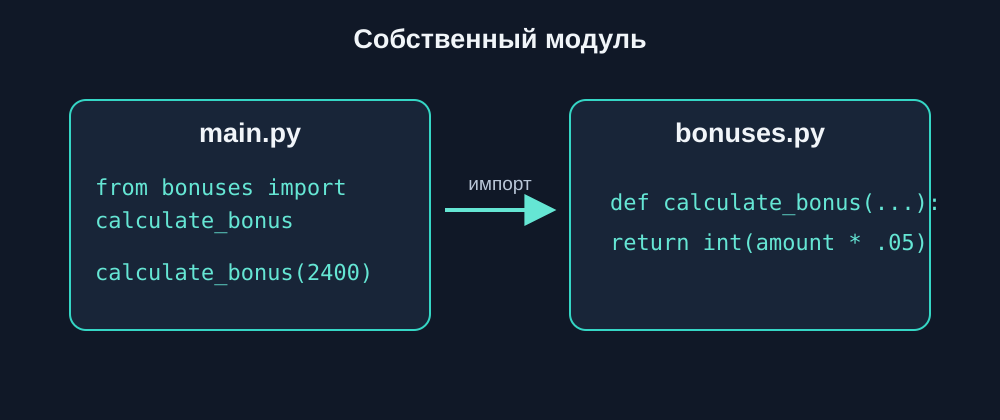
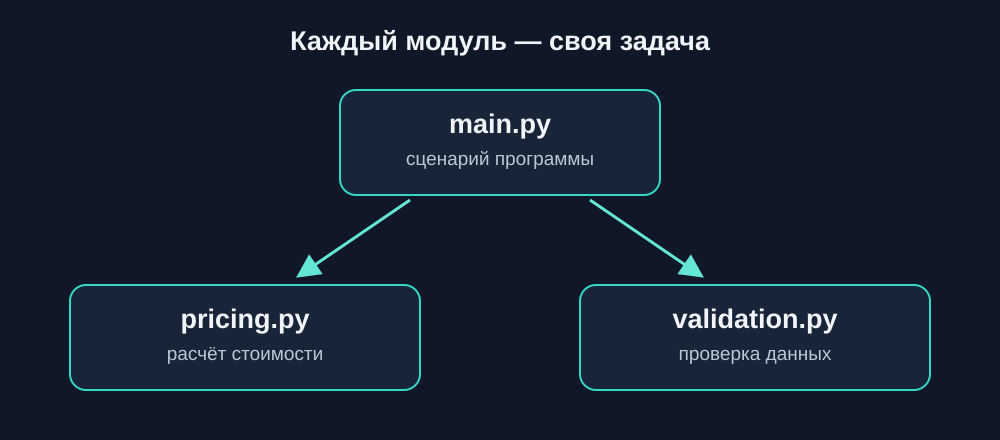
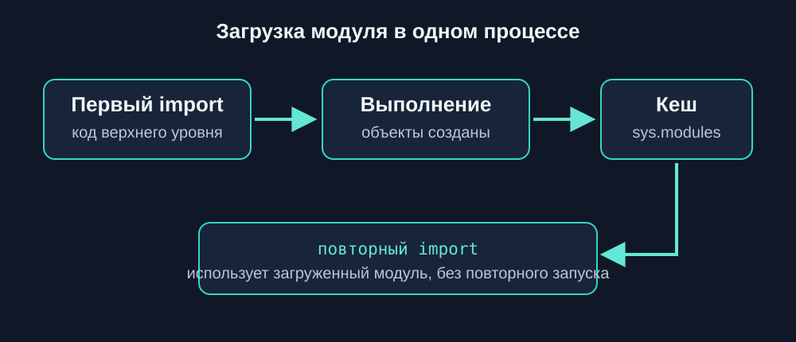
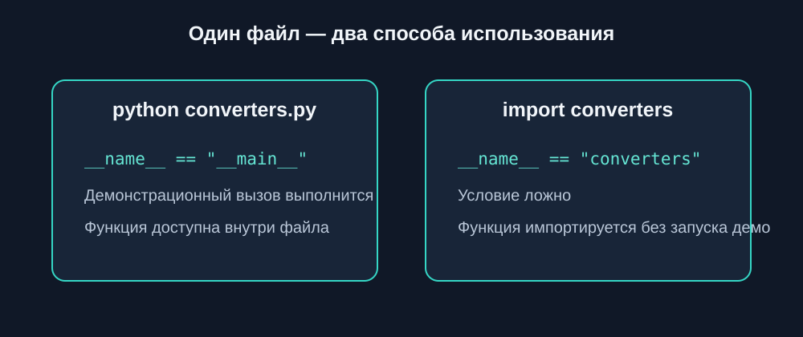
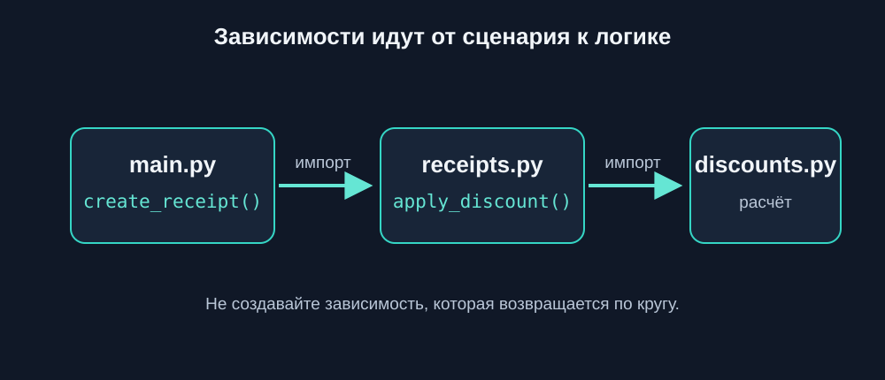

---
pagetitle: "Собственные модули Python: создание, импорт и организация кода"
description: "Как создавать собственные модули Python, импортировать функции из других файлов, использовать __name__ == '__main__' и организовывать многофайловые программы."
keywords:
  - собственные модули Python
  - создание модулей Python
  - импорт собственных модулей
  - Python main.py
  - Python __name__ main
  - организация кода Python
---

# 4.9 Собственные модули {.unnumbered}

В предыдущей главе мы познакомились с синтаксисом импорта. Теперь применим его к своим файлам: функцию, вынесенную в модуль, можно использовать из разных частей программы без копирования.

## Создание первого модуля

Представим небольшую программу для расчёта бонусных баллов.

Создадим два файла:

```text
bonus_project/
├── main.py
└── bonuses.py
```



В файле `bonuses.py` разместим функцию:

```python
def calculate_bonus(amount):
    return int(amount * 0.05)
```

Теперь в `main.py` импортируем модуль:

```python
import bonuses

points = bonuses.calculate_bonus(2400)

print("Бонусные баллы:", points)
```

Результат:

```text
Бонусные баллы: 120
```

Здесь `bonuses.py` — наш собственный модуль.

Python находит его по имени `bonuses`, а затем предоставляет доступ к функции через точку.

::: {.callout-note title="Как запустить пример"}

Сохраните оба файла в одном каталоге и запустите:

```bash
python main.py
```

Для этой главы важно работать именно с несколькими файлами, а не только с отдельными фрагментами кода.
:::

## Импорт функций из собственного модуля

Мы уже знакомы с конструкцией `from ... import`.

Она работает и с собственными модулями.

Создадим файл `formatters.py`:

```python
def format_price(price):
    return f"{price:.2f} ₽"


def format_username(name):
    return name.strip().title()
```

В `main.py`:

```python
from formatters import format_price, format_username

print(format_price(1499.5))
print(format_username("  анна  "))
```

Результат:

```text
1499.50 ₽
Анна
```

Теперь функции форматирования можно использовать в разных частях проекта.

При этом основная программа не содержит их реализацию.

## Разделение ответственности



Когда программа растёт, удобно группировать функции по назначению.

Например:

```text
shop/
├── main.py
├── pricing.py
└── validation.py
```

В `pricing.py`:

```python
def calculate_total(price, quantity):
    return price * quantity
```

В `validation.py`:

```python
def validate_quantity(quantity):
    if quantity <= 0:
        raise ValueError(
            "Количество должно быть положительным"
        )
```

В `main.py`:

```python
from pricing import calculate_total
from validation import validate_quantity

try:
    quantity = 3

    validate_quantity(quantity)

    total = calculate_total(1200, quantity)

except ValueError as error:
    print("Ошибка:", error)

else:
    print("Стоимость заказа:", total)
```

Результат:

```text
Стоимость заказа: 3600
```

Каждый файл решает свою задачу:

- `main.py` управляет выполнением программы;
- `pricing.py` содержит расчёты;
- `validation.py` проверяет данные.

Такой подход помогает изменять одну часть программы, не смешивая её с остальными.

## Что происходит при импорте модуля

Рассмотрим файл `messages.py`:

```python
print("Модуль messages загружен")


def show_message(text):
    print("Сообщение:", text)
```

Теперь `main.py`:

```python
import messages

messages.show_message("Добро пожаловать")
```

Результат:

```text
Модуль messages загружен
Сообщение: Добро пожаловать
```

Почему появилась первая строка?

При первом обычном импорте Python выполняет код верхнего уровня модуля.

А тело функции выполняется только при её вызове.

Это означает, что инструкции вне функций могут запускаться даже тогда, когда мы хотели просто импортировать готовую функцию.

::: {.callout-warning title="Избегайте неожиданных действий при импорте"}

Не размещайте без необходимости `input()`, тестовые запуски или изменение данных на верхнем уровне переиспользуемого модуля.

Такие действия могут неожиданно выполняться при его импорте.
:::

## Повторный импорт



В рамках одного процесса Python обычно сохраняет уже загруженный модуль.

Например:

```python
import messages
import messages
```

При обычном повторном импорте код верхнего уровня не выполняется заново.

Python использует уже загруженный модуль из своего кеша.

Это поведение важно учитывать, если в модуле есть инструкции, которые выполняются при загрузке.

## Конструкция __name__ == "__main__"



Иногда нужно, чтобы один и тот же файл можно было:

- запускать как самостоятельную программу;
- импортировать без запуска демонстрационного кода.

Для этого используется:

```python
if __name__ == "__main__":
```

Создадим `converters.py`:

```python
def celsius_to_fahrenheit(celsius):
    return celsius * 9 / 5 + 32


if __name__ == "__main__":
    print(celsius_to_fahrenheit(20))
```

При прямом запуске:

```bash
python converters.py
```

Результат:

```text
68.0
```

Но если создать `main.py`:

```python
from converters import celsius_to_fahrenheit

print(celsius_to_fahrenheit(30))
```

Результат будет:

```text
86.0
```

Демонстрационный вызов с числом `20` при импорте не выполнится.

## Как работает __name__

Python автоматически определяет специальную переменную `__name__`.

Её значение зависит от способа запуска файла.

| Сценарий | Значение `__name__` |
|---|---|
| Прямой запуск файла | `"__main__"` |
| Обычный импорт `converters` | `"converters"` |

Поэтому проверка:

```python
if __name__ == "__main__":
```

позволяет отделить код самостоятельного запуска от функций, предназначенных для импорта.

::: {.callout-tip title="Практическое правило"}

Функции размещайте отдельно, а демонстрационный запуск — внутри блока:

```python
if __name__ == "__main__":
    ...
```

Так модуль удобно использовать и самостоятельно, и в других программах.
:::

## Импорт между файлами проекта



Рассмотрим программу обработки заказов:

```text
orders_project/
├── main.py
├── discounts.py
└── receipts.py
```

Файл `discounts.py`:

```python
def apply_discount(price, percent):
    return price * (1 - percent / 100)
```

Файл `receipts.py`:

```python
from discounts import apply_discount


def create_receipt(product, price, discount):
    final_price = apply_discount(price, discount)

    return {
        "product": product,
        "total": final_price
    }
```

Файл `main.py`:

```python
from receipts import create_receipt

receipt = create_receipt(
    "Клавиатура",
    2500,
    10
)

print(receipt)
```

Результат:

```text
{'product': 'Клавиатура', 'total': 2250.0}
```

Обратите внимание: модуль `receipts.py` сам импортирует функцию из `discounts.py`.

Таким образом, модули могут использовать друг друга.

Но не стоит создавать запутанные цепочки зависимостей без необходимости.

## Общие данные в модуле

Модуль может содержать не только функции, но и константы.

Например, `settings.py`:

```python
APP_NAME = "Task Manager"
MAX_TASKS = 100
DEFAULT_LANGUAGE = "ru"
```

В `main.py`:

```python
import settings

print(settings.APP_NAME)
print(settings.MAX_TASKS)
```

Результат:

```text
Task Manager
100
```

Имена констант обычно записывают заглавными буквами.

Это соглашение показывает, что значение не предполагается изменять во время работы программы.

При этом Python технически не запрещает присвоить такой переменной новое значение.

## Как выбирать имена модулей

Имя файла должно объяснять его назначение.

Хорошие примеры:

```text
pricing.py
validation.py
formatters.py
notifications.py
```

Менее удачные:

```text
utils2.py
everything.py
my_code.py
```

Для имён модулей обычно используют строчные буквы и при необходимости подчёркивания.

Не стоит называть собственные файлы именами стандартных модулей:

```text
random.py
math.py
datetime.py
```

Это может привести к конфликтам при импорте.

## Типичные ошибки

### ModuleNotFoundError

Если файл отсутствует в доступных путях импорта:

```python
import missing_module
```

Python может сообщить:

```text
ModuleNotFoundError
```

Проверьте имя файла и расположение модулей.

### ImportError

Если модуль существует, но нужного имени в нём нет:

```python
from bonuses import unknown_function
```

Возникнет `ImportError`.

### Код запускается при импорте

Если в модуле находятся инструкции верхнего уровня:

```python
print("Тестовый запуск")
```

они выполняются при первой загрузке модуля.

Для демонстрационного кода используйте защитную конструкцию с `__name__`.

### Циклические импорты

Представим:

```text
a.py импортирует b.py
b.py импортирует a.py
```

Такая зависимость может привести к ошибкам из-за частично инициализированных модулей.

В небольших проектах лучше разделять общую логику так, чтобы файлы не зависели друг от друга по кругу.

Подробную организацию зависимостей изучим позже.

## Что важно запомнить

Собственный модуль — обычный `.py`-файл, код которого можно использовать в другом файле.

Например:

```python
import bonuses
```

или:

```python
from bonuses import calculate_bonus
```

При первом обычном импорте Python выполняет код верхнего уровня модуля.

Конструкция:

```python
if __name__ == "__main__":
    ...
```

помогает отделить самостоятельный запуск от импорта.

Главная идея:

**Разделяйте программу на модули по назначению, а не просто ради увеличения количества файлов.**

---

### Практические задания

**Задание 1. Модуль приветствий**

**Сложность: начальная**

Создайте два файла:

```text
greetings_project/
├── main.py
└── greetings.py
```

В `greetings.py` напишите функцию `greet(name)`, которая возвращает строку приветствия.

В `main.py` импортируйте функцию и выведите приветствие для пользователя `"Мария"`.

::: {.callout-note title="Ответ" collapse="true"}

`greetings.py`:

```python
def greet(name):
    return f"Привет, {name}!"
```

`main.py`:

```python
from greetings import greet

print(greet("Мария"))
```

Результат:

```text
Привет, Мария!
```

:::

**Задание 2. Модуль конвертации времени**

**Сложность: начальная**

Создайте модуль `time_utils.py` с двумя функциями:

- `hours_to_minutes(hours)`;
- `days_to_hours(days)`.

В `main.py` используйте обе функции для преобразования 3 часов и 2 дней.

::: {.callout-note title="Ответ" collapse="true"}

`time_utils.py`:

```python
def hours_to_minutes(hours):
    return hours * 60


def days_to_hours(days):
    return days * 24
```

`main.py`:

```python
import time_utils

print(time_utils.hours_to_minutes(3))
print(time_utils.days_to_hours(2))
```

Результат:

```text
180
48
```

:::

**Задание 3. Настройки приложения**

**Сложность: начальная**

Создайте модуль `config.py`, содержащий:

```python
APP_NAME = "Study Planner"
VERSION = "1.0"
MAX_USERS = 50
```

В `main.py` импортируйте модуль и выведите информацию о приложении.

::: {.callout-note title="Ответ" collapse="true"}

`config.py`:

```python
APP_NAME = "Study Planner"
VERSION = "1.0"
MAX_USERS = 50
```

`main.py`:

```python
import config

print("Приложение:", config.APP_NAME)
print("Версия:", config.VERSION)
print("Лимит пользователей:", config.MAX_USERS)
```

:::

**Задание 4. Модуль проверки оценок**

**Сложность: средняя**

Создайте модуль `grades.py`.

В нём должна быть функция `validate_grade(grade)`.

Она проверяет, что оценка находится в диапазоне от `1` до `5`.

Если значение некорректно, функция создаёт `ValueError`.

В `main.py` проверьте несколько оценок и обработайте исключения.

::: {.callout-note title="Ответ" collapse="true"}

`grades.py`:

```python
def validate_grade(grade):
    if grade < 1 or grade > 5:
        raise ValueError("Оценка должна быть от 1 до 5")

    return grade
```

`main.py`:

```python
from grades import validate_grade

grades = [5, 3, 8, 2]

for grade in grades:
    try:
        print("Оценка:", validate_grade(grade))

    except ValueError as error:
        print("Ошибка:", error)
```

:::

**Задание 5. Самостоятельный запуск модуля**

**Сложность: средняя**

Создайте модуль `temperature.py`.

В нём реализуйте функцию:

```python
fahrenheit_to_celsius(fahrenheit)
```

Добавьте проверку `__name__ == "__main__"` для демонстрационного расчёта.

В отдельном `main.py` импортируйте функцию и вызовите её с другим значением.

Убедитесь, что демонстрационный код не запускается при импорте.

::: {.callout-note title="Ответ" collapse="true"}

`temperature.py`:

```python
def fahrenheit_to_celsius(fahrenheit):
    return (fahrenheit - 32) * 5 / 9


if __name__ == "__main__":
    print(fahrenheit_to_celsius(68))
```

`main.py`:

```python
from temperature import fahrenheit_to_celsius

print(fahrenheit_to_celsius(86))
```

При прямом запуске `temperature.py`:

```text
20.0
```

При запуске `main.py`:

```text
30.0
```

:::

**Задание 6. Обработка результатов соревнования**

**Сложность: средняя**

Создайте проект:

```text
competition/
├── main.py
├── scoring.py
└── formatting.py
```

В `scoring.py` напишите функцию для расчёта общего количества очков участника.

В `formatting.py` — функцию формирования строки результата.

В `main.py` используйте обе функции для вывода результатов нескольких участников.

::: {.callout-note title="Ответ" collapse="true"}

`scoring.py`:

```python
def total_score(scores):
    return sum(scores)
```

`formatting.py`:

```python
def format_result(name, score):
    return f"{name}: {score} очков"
```

`main.py`:

```python
from scoring import total_score
from formatting import format_result

participants = {
    "Анна": [8, 9, 10],
    "Игорь": [7, 8, 9],
    "Мария": [10, 10, 9]
}

for name, scores in participants.items():
    total = total_score(scores)
    print(format_result(name, total))
```

:::

**Задание 7. Система складского учёта**

**Сложность: повышенная**

Создайте проект:

```text
warehouse/
├── main.py
├── inventory.py
└── validation.py
```

В `inventory.py` реализуйте функцию `remove_stock(stock, product, quantity)`.

В `validation.py` — проверку положительного количества товара.

Программа должна:

1. Проверять корректность количества.
2. Проверять наличие товара.
3. Проверять достаточный остаток.
4. Уменьшать остаток только после успешных проверок.
5. Обрабатывать ожидаемые ошибки в `main.py`.

::: {.callout-note title="Ответ" collapse="true"}

`validation.py`:

```python
def validate_quantity(quantity):
    if type(quantity) is not int or quantity <= 0:
        raise ValueError("Количество должно быть положительным целым числом")
```

`inventory.py`:

```python
from validation import validate_quantity


def remove_stock(stock, product, quantity):
    validate_quantity(quantity)

    if product not in stock:
        raise ValueError("Товар не найден")

    if stock[product] < quantity:
        raise ValueError("Недостаточный остаток")

    stock[product] -= quantity
```

`main.py`:

```python
from inventory import remove_stock

stock = {
    "Ноутбук": 5,
    "Мышь": 12
}

try:
    remove_stock(stock, "Ноутбук", 2)

except ValueError as error:
    print("Ошибка:", error)

else:
    print("Остатки:", stock)
```

:::

**Задание 8. Мини-проект: управление задачами**

**Сложность: повышенная**

Создайте приложение:

```text
task_manager/
├── main.py
├── tasks.py
├── validation.py
└── reports.py
```

Требования:

- `validation.py` проверяет название задачи;
- `tasks.py` добавляет задачи в список;
- `reports.py` формирует текстовый отчёт;
- `main.py` управляет выполнением программы.

Добавьте несколько задач, обработайте некорректные названия и выведите итоговый отчёт.

::: {.callout-note title="Ответ" collapse="true"}

`validation.py`:

```python
def validate_title(title):
    if not isinstance(title, str) or not title.strip():
        raise ValueError("Название задачи не может быть пустым")
```

`tasks.py`:

```python
from validation import validate_title


def add_task(tasks, title):
    validate_title(title)

    tasks.append({
        "title": title.strip(),
        "completed": False
    })
```

`reports.py`:

```python
def create_report(tasks):
    lines = []

    for task in tasks:
        status = "Готово" if task["completed"] else "В работе"

        lines.append(f"{task['title']} — {status}")

    return "\n".join(lines)
```

`main.py`:

```python
from tasks import add_task
from reports import create_report

tasks = []

titles = [
    "Изучить модули",
    "",
    "Написать программу",
    "Проверить код"
]

for title in titles:
    try:
        add_task(tasks, title)

    except ValueError as error:
        print("Ошибка:", error)

print("\nОтчёт:")
print(create_report(tasks))
```

:::

---

## Что дальше?

Теперь мы умеем создавать собственные модули и объединять несколько Python-файлов в одну программу.

Но что произойдёт, когда количество модулей вырастет до нескольких десятков?

Хранить все файлы в одном каталоге станет неудобно.

В следующей главе — [**«Пакеты»**](30-packages.qmd) — разберём, как объединять связанные модули в более крупные структуры проекта.

---

## Собственные модули Python: краткое резюме

Собственный модуль Python — это файл `.py`, содержащий функции, константы и другие объекты, которые можно импортировать в другие части программы.

Для подключения собственных модулей используются знакомые конструкции `import` и `from ... import`. При первой обычной загрузке модуля Python выполняет его код верхнего уровня, поэтому демонстрационные действия удобно помещать под проверку `if __name__ == "__main__":`.

Разделение программы на несколько модулей позволяет организовать код по назначению, уменьшить дублирование и упростить повторное использование функций. Это важный шаг от отдельных учебных скриптов к полноценным Python-проектам.
